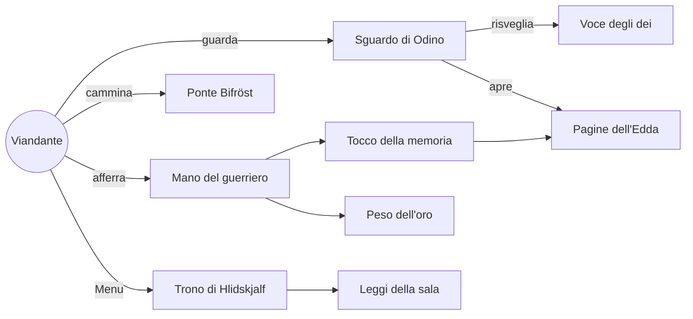
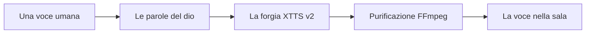

<div align="center">

<a href="#prologo"></a>


<br/>

**[Prologo](#prologo)** ᛫ **[Lo Scaldo](#scaldo)** ᛫ **[I Nove Mondi](#mondi)** ᛫ **[Il Pantheon](#pantheon)** ᛫ **[Il Banchetto](#banchetto)** ᛫ **[La Fucina](#fucina)** ᛫ **[La Voce](#voce)** ᛫ **[La Soglia](#soglia)** ᛫ **[Le Norne](#norne)**

</div>

<br/>

<a id="prologo"></a>
<table>
<tr>
<td width="55%" valign="top">

<h2>ᚨ Prologo</h2>

Il vento del nord ulula oltre le porte di legno.
La neve copre il sentiero alle tue spalle e davanti a te si apre una sala lunga quanto il ricordo di un popolo intero.

Le torce crepitano. L'idromele scorre nei corni.
Lungo le tavole siedono figure che conosci soltanto dai canti: **un vecchio con un solo occhio** che ti scruta da sotto il cappuccio, **un gigante dalla barba rossa** che ride più forte del tuono.

Non sei un guerriero. Non sei un re.
Sei un **viandante**, e questa notte gli dei hanno deciso di raccontarti chi erano.

*Questa è la Sala dello Scaldo.*

</td>
<td width="45%" align="center">


<sub><i>Odino, il Padre di Tutti</i><br/>Carl Emil Doepler, 1905 · pubblico dominio</sub>

</td>
</tr>
</table>

<div align="center">

> ### *"Benvenuto, viandante. Siedi alla mia tavola e ascolta."*
> **Odino**, all'apertura della sala


<a id="scaldo"></a>
<h2>ᛁ · Chi era lo Scaldo</h2>

</div>

Nell'antica Scandinavia lo **skáld** era la memoria vivente della sua gente. Nelle grandi sale dei re cantava le imprese degli eroi e i misteri degli dei, intrecciando i versi con le *kenning*, metafore in cui il mare diventa *"la strada delle balene"* e la battaglia *"la tempesta delle spade"*.

Si credeva che il dono della poesia venisse da **Odino**, che lo aveva rubato ai giganti sotto forma di un idromele magico: l'**Idromele della Poesia**. Chi lo beveva diventava scaldo.

Quei canti sopravvissero in due raccolte islandesi del XIII secolo:

<table>
<tr>
<td align="center" width="50%">

**ᛖ L'Edda Poetica**

Carmi antichissimi custoditi nel *Codex Regius*. Contiene la **Völuspá**, la profezia della veggente sulla nascita e la fine del mondo, e l'**Hávamál**, i detti dell'Altissimo.

</td>
<td align="center" width="50%">

**ᛋ L'Edda in Prosa**

Scritta da **Snorri Sturluson** intorno al 1220 come manuale per i giovani scaldi, perché la memoria degli dei non andasse perduta.

</td>
</tr>
</table>

**The Skald's Hall** nasce da qui. Non vuole spiegare la mitologia norrena: vuole fartela **abitare**.

<div align="center">


<a id="mondi"></a>
<h2>ᛁᛁ · I Nove Mondi</h2>


<sub><i>Il frassino Yggdrasil</i> · Friedrich Wilhelm Heine, 1886 · pubblico dominio</sub>

</div>

Al centro di tutto si erge **Yggdrasil**, il frassino cosmico. I suoi rami reggono il cielo, le sue radici affondano nell'abisso, e nove mondi sono sospesi tra le sue fronde.

<div align="center">

| | Mondo | Abitanti |
|:-:|:--|:--|
| ᚨ | **Asgard** | Gli Æsir, dei della guerra e del governo |
| ᚡ | **Vanaheim** | I Vanir, dei della fertilità e della magia |
| ᛚ | **Álfheim** | Gli elfi della luce |
| ᛗ | **Midgard** | Gli uomini |
| ᛃ | **Jötunheim** | I giganti, nemici eterni degli dei |
| ᛞ | **Svartálfheim** | I nani, fabbri di Mjöllnir |
| ᚾ | **Niflheim** | Il regno del gelo e della nebbia |
| ᛊ | **Muspelheim** | Il regno del fuoco, dove attende Surtr |
| ᚺ | **Helheim** | Il regno dei morti senza gloria |

</div>

La sala in cui entrerai si trova ad **Asgard**: un'eco del **Valhalla**, dove ogni sera gli eroi banchettano in attesa dell'ultima battaglia.

<div align="center">


<a id="pantheon"></a>
<h2>ᛁᛁᛁ · Coloro che siedono alla tavola</h2>

</div>

<table>
<tr>
<td width="35%" align="center">


</td>
<td width="65%" valign="top">

### ᚨ ODINO
**Alfǫðr · Padre di Tutti · Signore della Sala**

Ha sacrificato un occhio alla fonte di Mímir in cambio della saggezza. È rimasto appeso nove notti all'albero del mondo per strappare all'abisso il segreto delle **rune**. Due corvi, *Huginn* (Pensiero) e *Muninn* (Memoria), gli riportano ogni giorno ciò che accade nei mondi.

Nella sala è il **padrone di casa**: accoglie il viandante e gli offre l'idromele.

> *"Questo idromele fu versato per gli eroi caduti. Bevi, se ne sei degno."*

</td>
</tr>
<tr>
<td width="35%" align="center">


</td>
<td width="65%" valign="top">

### ᚦ THOR
**Þórr · Il Tonante · Protettore di Midgard**

Figlio di Odino, attraversa i cieli su un carro trainato da due capri. Quando cala **Mjöllnir**, forgiato dai nani, il cielo si spacca in fulmini. Non è il più saggio tra gli dei, ma il più leale. Il suo destino è affrontare il Serpente del Mondo nell'ultimo giorno.

Nella sala la sua risata copre il fragore delle torce.

</td>
</tr>
</table>

<details>
<summary><b>ᛉ Altri seggi attendono i loro dei</b></summary>

<br/>

- **Freyja**, signora dei Vanir e della magia *seiðr*
- **Loki**, il mutaforma, amico e traditore degli dei
- **Heimdall**, guardiano del Bifröst, che sente crescere l'erba
- **Frigg**, la regina che conosce ogni destino e non lo rivela

</details>

<div align="center">


<a id="banchetto"></a>
<h2>ᛁᚢ · La Notte del Banchetto</h2>


<sub><i>La sala del banchetto, così come appare nel gioco</i></sub>

</div>

L'esperienza si svolge in **una sola notte**, divisa in atti come un antico carme.

> **ᚠ Atto Primo · La Soglia**
> Varchi le porte. Tavole imbandite, tappeti intessuti, il calore delle torce. Nessuno ti ferma. Sei atteso.

> **ᚢ Atto Secondo · Lo Sguardo degli Dei**
> Gli dei non parlano a chi passa distratto. Fermati davanti a uno di loro e **sostienine lo sguardo**: ti rivolgerà la parola, e una pagina di conoscenza si aprirà nell'aria come vetro sottile.

> **ᚦ Atto Terzo · I Tesori della Sala**
> Calici d'oro, bracciali intrecciati, scrigni ornati. **Prendili tra le mani**: ogni oggetto racconta la sua storia solo a chi lo stringe. Lanciali, se osi: il metallo risuona contro il legno.

> **ᚨ Atto Quarto · L'Idromele**
> Odino ti offre il corno. Bere significa entrare nella memoria degli dei e diventare a tua volta **scaldo**.

<details>
<summary><b>ᚱ Come si gioca</b></summary>

<br/>

| Gesto | Cosa accade |
|:--|:--|
| **Spingi lo stick e rilascia** | Un passo di luce: un battito di ciglia e sei altrove |
| **Stringi il grip** | Afferri un oggetto e si apre la sua storia |
| **Apri la mano in movimento** | Lanci l'oggetto con la forza del tuo braccio |
| **Guarda un dio per qualche istante** | Il dio ti nota e ti parla |
| **Tasto Menu** | Un pannello sospeso appare davanti a te |
| **Le tue mani** | Con l'hand tracking indichi, afferri, alzi il pollice |

Si può giocare **in piedi** o **seduti**, come un ospite al banchetto.

</details>

<details>
<summary><b>ᛈ Perché un serious game</b></summary>

<br/>

Gli scaldi non insegnavano con i libri, ma con la **voce**, nello **spazio** della sala.

| Sui libri | Nella Sala |
|:--|:--|
| Leggi che Odino accoglieva gli eroi | Odino accoglie **te** |
| Guardi la foto di un calice | Lo sollevi e lo fai risuonare |
| Una didascalia descrive il reperto | La sua storia appare mentre lo stringi |
| Un narratore anonimo racconta | Un dio ti guarda negli occhi e ti parla |

</details>

<div align="center">


<a id="fucina"></a>
<h2>ᚢ · La Fucina dei Nani</h2>


<sub><i>Walhall</i> · Emil Doepler, 1905 · pubblico dominio</sub>

*Come i nani di Svartálfheim forgiarono Mjöllnir, così questa sala è stata forgiata riga per riga.*

</div>

<details>
<summary><b>ᛞ Gli strumenti della forgia</b></summary>

<br/>

| Strumento | Uso |
|:--|:--|
| **Unreal Engine 5.6** | Il motore che dà forma alla sala |
| **OpenXR**, Hand Tracking, Eye Tracking | Le mani e lo sguardo del viandante |
| **C++** | I sistemi di interazione |
| **MetaHuman, RigLogic, LiveLink** | I volti degli dei |
| **OVRLipSync** | Le labbra che seguono le parole |
| **Behavior Tree** | Gli dei che si muovono per la sala |
| **Coqui XTTS v2** | Le voci degli dei, in italiano |

</details>

<details>
<summary><b>ᛗ Le rune incise nel codice</b></summary>

<br/>

| Nel mito | Nel codice | Cosa fa |
|:--|:--|:--|
| *La voce degli dei* | `UNPCDialogueComponent` | Battute, sottotitoli, gesti, lip sync |
| *Lo sguardo di Odino* | `UNPCGazeGreeterComponent` | Il dio reagisce dopo 2.5 s di sguardo, entro 6 m |
| *Le pagine dell'Edda* | `AGlassCardActor` | Schede di vetro che fluttuano verso il viandante |
| *Il tocco della memoria* | `UGrabInfoTriggerComponent` | Afferrare un oggetto ne apre la storia |
| *La mano del guerriero* | `UHandGrabComponent` | Presa fisica realistica, con lancio |
| *Il peso dell'oro* | `UStoricaItemComponent` | Suono e scintille proporzionati all'urto |
| *Il ponte Bifröst* | `UVRTeleportComponent` | Teleport ad arco con blink anti-nausea |
| *La tavola sempre imbandita* | `UObjectPoolComponent` | Oggetti pre-forgiati, nessuno scatto |
| *L'occhio che vede lontano* | `USignificanceManagerComponent` | Gli dei lontani si alleggeriscono |
| *Il trono di Hlidskjalf* | `AVisionMenuActor` | Il menu sospeso che segue lo sguardo |
| *Le leggi della sala* | `UVRSettingsSubsystem` | Volume, altezza, modalità seduti |

</details>

<details>
<summary><b>ᛜ Come i sistemi si intrecciano</b></summary>

<br/>



</details>

<details>
<summary><b>ᛟ Incidere una storia su un oggetto</b></summary>

<br/>

1. Posa una **GlassCardActor** accanto all'oggetto e imposta `bStartClosed = true`.
2. Seleziona l'oggetto afferrabile, poi **+ Add** e scegli **Grab Info Trigger**.
3. Nel campo **Linked Card** indica la scheda con la pipetta.

</details>

<div align="center">


<a id="voce"></a>
<h2>ᚢᛁ · Dare Voce agli Dei</h2>

</div>

Nelle sale antiche nessun canto era scritto: tutto viveva nella voce. Anche qui ogni dio ha una **voce propria**, generata a partire da pochi secondi di registrazione.



<details>
<summary><b>ᛇ Il rito della voce</b></summary>

<br/>

1. **Registra** 6-15 secondi di voce grave, senza musica né eco, in `TTS/refs/<dio>_ref.wav`.
2. **Scrivi** le battute in `TTS/lines.csv`: al massimo due frasi per riga, con i nomi scritti come si pronunciano (*"Miòlnir"*).
3. **Chiudi Unreal Engine** ed esegui `python gen_voices.py`.
4. **Purifica** l'audio con FFmpeg (48 kHz, normalizzazione, taglio dei silenzi).
5. **Porta la voce nella sala**: `Content/Audio/Voices/<Dio>/`.

Istruzioni complete in `TTS/Istruzioni.txt`. Licenza XTTS v2: **CPML, uso non commerciale**.

</details>

<div align="center">


<a id="soglia"></a>
<h2>ᚢᛁᛁ · Varcare la Soglia</h2>

</div>

<details>
<summary><b>ᚹ Ciò che serve al viandante</b></summary>

<br/>

| | |
|:--|:--|
| **Motore** | Unreal Engine 5.6 |
| **Sistema** | Windows 10 / 11 |
| **Visore** | Qualsiasi visore OpenXR (Meta Quest con Link, Valve Index, HTC Vive) |
| **Forgia del codice** | Visual Studio 2022 o Rider |
| **Per le voci** | Python, FFmpeg, GPU con circa 12 GB di VRAM |

</details>

<details>
<summary><b>ᚷ Il cammino</b></summary>

<br/>

```bash
git lfs install
git clone https://github.com/tommasomilleri/TheSkaldsHall.git
cd "TheSkaldsHall/The_Skalds_Hall 5.6"
```

1. Tasto destro su `The_Skalds_Hall.uproject`, poi **Generate Visual Studio project files**.
2. Compila in `Development Editor | Win64`.
3. Apri `Livelli/MenuPrincipale` e avvia **VR Preview**.

</details>

<details>
<summary><b>ᚾ Quando la strada si fa oscura</b></summary>

<br/>

| Presagio | Rimedio |
|:--|:--|
| Il Bifröst non si apre (teleport) | Aggiungi un `NavMeshBoundsVolume` |
| L'oggetto tace quando lo afferri | Collega la `Linked Card` |
| L'oggetto fluttua lontano dalla mano | Usa `HandGrabComponent` |
| La forgia delle voci si spegne (CUDA out of memory) | Chiudi Unreal Engine |
| La voce suona metallica | Accorcia la battuta |
| La sala del banchetto è vuota | `Scene_Banquet` è esclusa da Git: chiedila al team |

</details>

<details>
<summary><b>ᛏ Le leggi della sala (.gitignore)</b></summary>

<br/>

- **Restano fuori:** file generati da Unreal, MetaHuman, asset di Fab, la scena del banchetto, media pesanti, modelli di machine learning, ambienti Python.
- **Passano:** le voci finali degli dei e il modello di OVRLipSync.
- **Regola d'oro:** le eccezioni (`!`) vanno sempre dopo le esclusioni che annullano.

</details>

<div align="center">


<a id="norne"></a>
<h2>ᛁᚷ · Ciò che le Norne hanno filato</h2>

*Urðr, Verðandi e Skuld filano il destino ai piedi di Yggdrasil. Questo è il filo della sala.*

| | Il filo | |
|:-:|:--|:-:|
| ᛟ | Il passo del Bifröst e il comfort del viandante | **compiuto** |
| ᛟ | La mano del guerriero e le pagine dell'Edda | **compiuto** |
| ᛟ | Lo sguardo e la voce di Odino | **compiuto** |
| ᛟ | Menu, pausa e leggi della sala | **compiuto** |
| ᛜ | I volti MetaHuman per ogni divinità | in corso |
| ᛜ | Labbra sincronizzate a ogni parola | in corso |
| ᛜ | Nuovi dei alla tavola | in attesa |
| ᛜ | Il cammino guidato e la prova dello scaldo | in attesa |


### ᛒ Coloro che hanno forgiato la sala

**Tommaso Milleri** · *Scaldo e fabbro*

<sub>
Unreal Engine 5.6 · Epic Games ᛫ AncientTreasures, MedCastle, RuinedCrypt ᛫ Ultimate UI SFX Pack · JDSherbert ᛫ Coqui XTTS v2 (CPML) ᛫ Meta OVRLipSync
<br/>
Illustrazioni: Carl Emil Doepler, Mårten Eskil Winge, Friedrich Wilhelm Heine · pubblico dominio via Wikimedia Commons
</sub>

<br/><br/>

> *Deyr fé, deyja frændr,*
> *deyr sjálfr it sama;*
> *en orðstírr deyr aldregi*
> *hveim er sér góðan getr.*
>
> *Muore il bestiame, muoiono i parenti,*
> *anche tu stesso morirai;*
> *ma la fama non muore mai*
> *per chi se l'è guadagnata.*
>
> **Hávamál, 76**

<br/>

**ᚦ ᛖ ᛫ ᛋ ᚴ ᚨ ᛚ ᛞ ᛋ ᛫ ᚺ ᚨ ᛚ ᛚ**

</div>